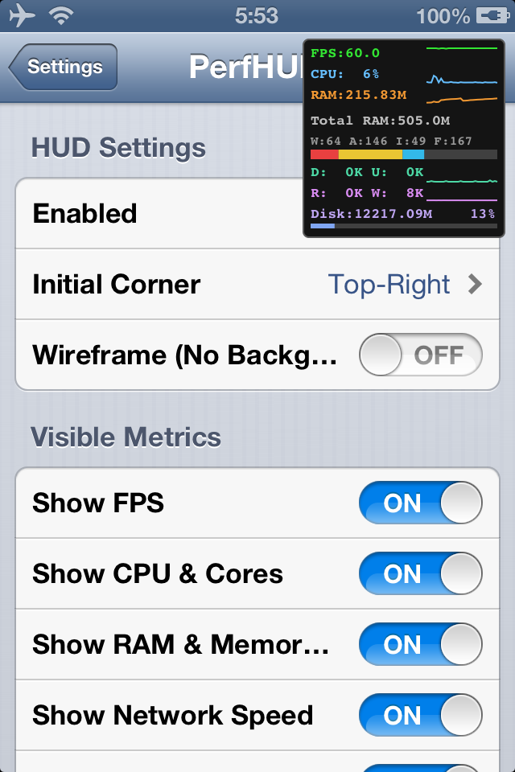

# PerfHUD for iOS 6

Zero-footprint real-time performance HUD and CLI telemetry monitor for legacy iOS (ARMv7, iOS 6.0–6.1.6).

<p align="center">
  <br>
  <i>PerfHUD v1.1.0 running on iPhone 4 (iOS 6.1.3)</i>
</p>


## Features

- **Real-Time Display:**
  - **FPS & Frametime:** Hardware-synchronized via `CADisplayLink` (60 Hz VSync) with sparkline history graph.
  - **CPU Utilization:** Overall CPU load and per-core breakdown (`C0`, `C1` for Apple A5 dual-core; dynamic single-core mode on Apple A4) with sparklines and color thresholds.
  - **Memory Metrics:** Sub-MB precision RAM tracking with dedicated tall auto-scaling sparkline and stacked memory breakdown bar (`Wired`, `Active`, `Inactive`, `Free`).
  - **Network Speeds:** Zero-overhead Darwin network throughput (Download/Upload rates & incoming sparkline).
  - **NAND Disk I/O:** Hardware disk read/write throughput via IOKit and available storage with percentage bar.
- **Interactive Control:**
  - **Hide / Peek:** Tap to hide off-screen for 2 seconds leaving a thin tab, returning automatically.
  - **Corner Jump:** Tap to jump clockwise to the next screen corner.
- **CLI Telemetry Streaming (`perfhud-cli`):**
  - Stream metrics over SSH directly to your terminal without GUI overhead (`perfhud-cli -f`).
  - Zero NAND flash wear: writes atomically to RAM (`/var/tmp/perfhud.stat`).
- **Zero-Footprint Design:**
  - Single CoreGraphics render pass at 2 Hz (0.5s interval).
  - Per-metric toggles in Settings with CPU-saving mode (disabled metrics skip kernel queries).

## CLI Usage

Connect to your device over SSH:

```bash
# Single snapshot with timestamp:
perfhud-cli

# Output:
# [04:31:14] FPS:60.0 CPU: 11% (C0:12% C1:10%) RAM:242M/502M (W:87 A:109 I:12 F:230)

# Continuous real-time stream:
perfhud-cli -f
```

## Settings

Configurable via Settings.app $\to$ **PerfHUD**:
- **Enabled:** Toggle HUD overlay on/off.
- **Initial Corner:** Choose starting position (Top-Right, Bottom-Right, Bottom-Left, Top-Left).
- **Wireframe:** Transparent mode without solid background.

## License

MIT License. Author: noname122021.
